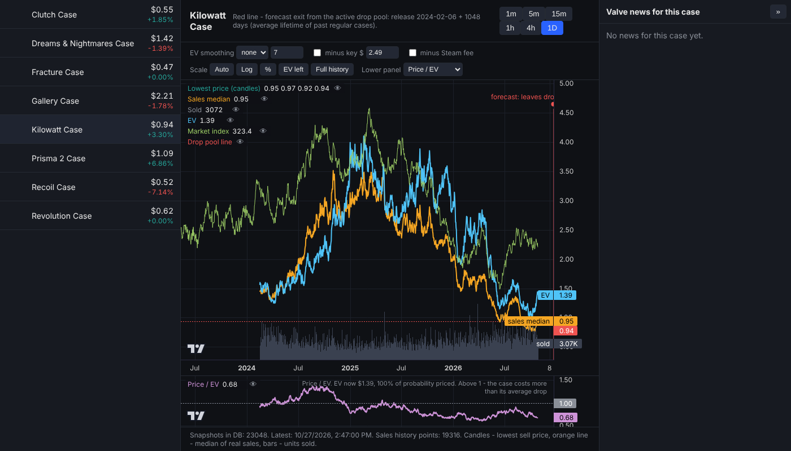
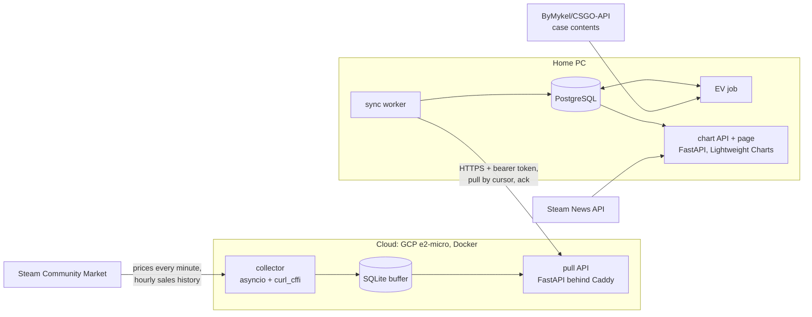

# CS2 Case Price Tracker

[](https://github.com/s96488-dev/cs-case-tracker/actions/workflows/ci.yml)

A small data pipeline that records the Steam Community Market price of every CS2 weapon case (~45) once a
minute, 24/7, pulls years of sales history, and computes a "fundamental" value for each case from the
prices of the ~10,000 skins, knives and gloves that can drop from it.

Collection runs on a free-tier cloud VM; the data lives in PostgreSQL on a home PC, which serves an
interactive chart page. The home PC can be off for days: the cloud buffers everything and the home side
catches up when it comes back.

Russian setup guide with every step: [docs/setup-ru.md](docs/setup-ru.md).


<sub>The chart page running on synthetic demo data.</sub>

## Quick start (demo)

```bash
docker compose -f docker-compose.demo.yml up --build
```

Open <http://localhost:8080>. This starts PostgreSQL and the home backend with synthetic data for a few
cases (real names, made-up prices), so no cloud VM or Steam account is needed.

## Architecture



The cloud keeps undelivered rows for up to 60 days, so the home PC can be off and catch up later.

- **cloud/**: an asyncio collector (case prices every minute, hourly sales history per case, item price
  history case by case), a SQLite buffer and a small FastAPI pull API. Caddy terminates TLS.
- **home/**: a sync worker that pulls new rows from the cloud into PostgreSQL, an EV calculator, a Valve
  news fetcher and a FastAPI app serving the chart page and a TradingView UDF datafeed.
- **common/**: Steam client and parsing, data models, case contents and drop odds, EV math, drop pool data.

## Key design decisions

- **Steam is the only price source, prices are stored in USD only.** Nothing is ever converted with
  today's exchange rate: if Steam returns history in another currency, only the sales volume is kept.
- **One request returns 10 cases.** The collector uses the same JSON search endpoint the market page calls
  (`market/search/render?norender=1`), so a full snapshot of all cases is ~5 requests a minute, no login.
- **Browser TLS fingerprint.** Requests go through `curl_cffi` impersonating Chrome. Plain Python clients
  (httpx, requests, urllib) are recognised by their TLS handshake and get `429` immediately. On `429` the
  collector keeps the pages it already has and backs off (2 to 15 minutes).
- **Pull, not push.** The home PC needs no public IP or open ports. Every buffered row has an increasing id;
  home stores its cursor in PostgreSQL and acknowledges what it saved. Rows and cursor are written in one
  transaction and inserts are idempotent, so dropped connections, restarts and even a recreated cloud
  buffer cause neither gaps nor duplicates.
- **Self-renewing Steam session.** Sales history (`market/pricehistory`) needs a logged-in cookie that
  lives 24 hours. The collector repeats what the browser does (`jwt/refresh` then `login/settoken`) with
  the long-lived refresh cookie, 2 hours before expiry.
- **Deploy via git.** The VM is a clone of this repo; cron runs `deploy/update.sh` every 5 minutes and
  rebuilds the containers when `main` moves. The home side does `git pull` on start.

## Case EV (expected value of opening)

EV is the sum of *item price × drop probability* over every market listing that can drop from the case:
each skin in each wear, StatTrak, knives and gloves.

- **Contents** come from the open [ByMykel/CSGO-API](https://github.com/ByMykel/CSGO-API) dataset (built
  from Valve game files, it includes each case's knives and gloves). Prices come only from Steam.
- **Odds**: official rarity odds (Mil-Spec 79.92%, Restricted 15.98%, Classified 3.2%, Covert 0.64%,
  knife/gloves 0.26%), StatTrak 10%, wear from the community float model mapped into each skin's float
  range (`common/case_contents.py`).
- **Item price on a day**: Steam exposes only an hourly/daily median and volume, not single trades, so the
  price is the volume-weighted median of the most recent days until at least 10 sales are covered
  (`common/ev.py`).
- A case is shown once prices cover at least 80% of its drop probability.

## Chart page

- Candles of the lowest sell price (1m to 1D), the median of real sales and units sold.
- EV line with optional SMA/EMA smoothing, minus key price and minus the Steam fee.
- Lower panel: *price / EV* (or *(case + key) / EV*), or *case / market index*. It pans, zooms and shows
  the crosshair together with the main chart.
- **Market index**: all cases equally weighted, chain-linked daily from mean log returns, starting at 100.
  Each case's price is smoothed over its last 7 days with sales, and a case joins 180 days after its first sale,
  so the price fall of newly released cases does not drag the index down. It also has its own entry at the end
  of the case list, daily only, with the market turnover ($ traded per day) in the lower panel.
- **Drop pool line**: when a regular case left the active drop pool, or a forecast for cases still in it
  (release date + the average lifetime of past regular cases, ~1050 days; `common/drop_pool.py`).
- Valve news mentioning the case, as markers and a side panel.
- Scale modes: auto, log, percent from the first visible bar, EV on its own scale. A TradingView-style
  legend with values under the crosshair and an eye to hide each series. Settings persist in the browser.

## Backtest

`backtest.bat` (or `python -m home.backtest`) tests case-buying signals on the home database and writes
`backtest_report.md`:

- a baseline: buying any case every week, for holding periods from 90 to 730 days;
- returns after 365 days grouped by the situation on the entry day: market drawdown, case drawdown, case vs
  market, price / EV, momentum, market turnover;
- buying right after a case left the active drop pool, and the market index by calendar month;
- a genetic search over rules ("buy when these conditions hold, sell after N days"), walk-forward: for each
  date in `--splits` it is fitted on the years before and reported on the years after, against the baseline
  with the same holding period. Fitness counts calendar quarters, not trades, so twenty cases bought during one
  market event count as one bet.

Every trade pays the Steam fee: 5% to Steam and 10% to the game, each at least 1 cent (a $0.03 sale pays out
$0.01). Signals use only data up to the entry day.

## Running it

**Cloud** (Debian VM with Docker):

```bash
cp .env.example .env            # set API_TOKEN, DOMAIN and optionally the Steam refresh cookie
docker compose up -d --build
curl https://<DOMAIN>/health     # last_success_at updates every minute
```

`sh deploy/setup-vm.sh` installs the auto-update cron, `sh deploy/set-steam-token.sh` stores the Steam
cookie (read with hidden input) and checks that renewal works.

**Home** (Windows, PostgreSQL 16+, Python 3.11+): copy `home\.env.example.bat` to `home\env.bat`, fill in
the postgres password, cloud URL and token, run `start-home.bat`, open <http://127.0.0.1:8080>.
`install-autostart.bat` starts it hidden on every login and restarts it if it crashes. The database and
tables are created automatically.

## Development

```bash
pip install -r requirements-dev.txt
ruff check . && mypy && pytest
```

Unit tests cover Steam parsing, drop odds, EV and the market index. `tests/test_pipeline.py` runs the whole
path (cloud buffer, pull API, home sync, PostgreSQL, chart API) against a disposable database given in
`TEST_DATABASE_URL`; CI runs everything on Python 3.11 and 3.13 with PostgreSQL 16.

## API

Home (port 8080):

| Request | Response |
|---|---|
| `GET /api/items` | all cases: latest price, listings, price 24 h ago |
| `GET /api/candles?item_id=7&tf=60` | OHLC of the lowest price; `tf`: `1`, `5`, `15`, `60`, `240` minutes or `1D` |
| `GET /api/sales?item_id=7&tf=1D` | sales history: median and units sold |
| `GET /api/ev?item_id=7` | daily EV in USD and `coverage` (priced share of probability) |
| `GET /api/market` | daily market index (`value`, starts at 100), number of cases and `turnover` ($ traded) |
| `GET /api/drop?item_id=7` | `released`, `left_active` or `forecast`, `mean_days` |
| `GET /api/news?item_id=7` | Valve news mentioning the case, newest first |
| `GET /api/status` | number of snapshots and the latest one |
| `GET /udf/*` | TradingView Charting Library datafeed |

Cloud (all but `/health` need `Authorization: Bearer <API_TOKEN>`): `GET /health`, `GET /api/stats`,
`GET /api/ticks?after_id=N`, `GET /api/sales?after_id=N`, `GET /api/item_days?after_id=N`,
`POST /api/ack`.

## Repository layout

| Path | What it is |
|---|---|
| `common/steam.py` | Steam requests, parsing, session renewal |
| `common/case_contents.py` | case contents and drop odds per market listing |
| `common/ev.py` | daily item prices and EV |
| `common/drop_pool.py` | active drop pool history and forecast |
| `common/backtest.py`, `home/backtest.py` | signal backtest, genetic search, report |
| `cloud/` | collector, SQLite buffer, pull API |
| `home/` | sync worker, PostgreSQL schema, EV job, news, chart API and page |
| `tests/` | unit tests and the end-to-end pipeline test |
| `deploy/` | VM setup, auto-update, Steam cookie setup |
| `Dockerfile`, `docker-compose.yml`, `Caddyfile` | cloud runtime with HTTPS |
| `*.bat` | Windows start and autostart scripts |
| `home.Dockerfile`, `docker-compose.demo.yml`, `home/demo.py` | one-command demo with synthetic data |

## Stack

Python 3.11+, asyncio, FastAPI, curl_cffi, SQLite, PostgreSQL (psycopg 3), Docker Compose, Caddy,
Google Cloud, Lightweight Charts.

## License

[MIT](LICENSE)
